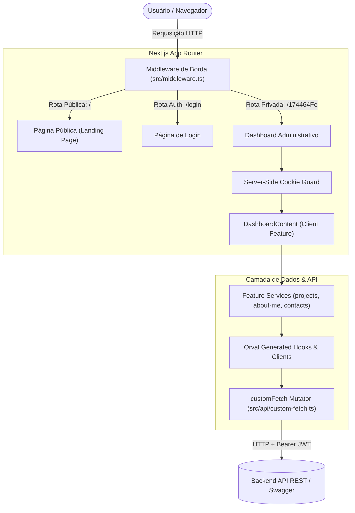
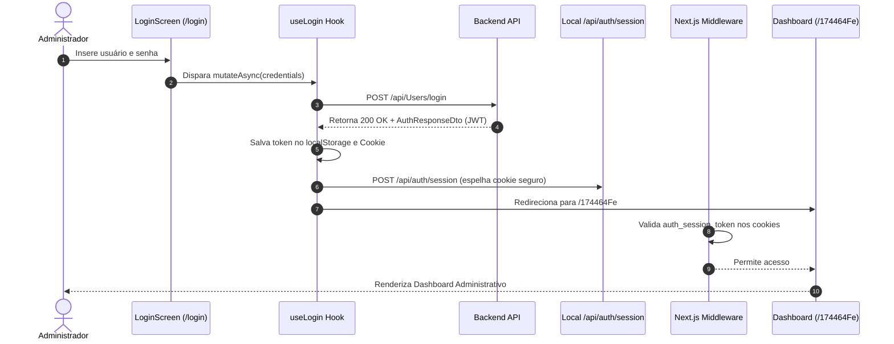

# Arquitetura do Sistema - Portfolio Frontend

Este documento descreve as decisões de arquitetura, padrões estruturais, ciclo de vida da autenticação e fluxo de dados do frontend.

---

## 1. Visão Geral da Arquitetura

O projeto adota uma arquitetura **Feature-Driven** (orientada por funcionalidades) aliada ao modelo de execução híbrido do **Next.js App Router (React Server Components + Client Components)**.

---

## 2. Organização em Módulos (Feature-Driven)

Todo o código de negócio está contido em `src/features/`. Cada módulo possui alta coesão e encapsula seus próprios componentes, hooks, serviços e schemas:

- `src/features/auth`: Telas de login, formulários Zod, hooks de autenticação (`useLogin`, `useLogout`) e tipos.
- `src/features/dashboard`: Componentes da área administrativa, painéis laterais de edição, modais de criação/edição e camada de serviços (`projects.service.ts`, `about-me.service.ts`, `contact.service.ts`).
- `src/features/hero`: Seção visual de boas-vindas e carrossel interativo.
- `src/features/about`: Apresentação de biografia e links sociais consumidos da API.
- `src/features/stacks`: Visualização em órbita do ecossistema de ferramentas e habilidades técnicas.
- `src/features/projects`: Vitrine de projetos públicos com filtros e links de demonstração.
- `src/features/contact`: Canais de contato direto (WhatsApp, Email, Redes).

---

## 3. Fluxo de Autenticação e Sessão Híbrida

Para garantir proteção eficiente e compatibilidade com SSR e Client Components, a autenticação utiliza uma estratégia em camadas:

### Características de Segurança Implementadas
1. **Defesa em Profundidade:**
   - **Borda (`middleware.ts`):** Intercepta acessos não autenticados a rotas protegidas antes de instanciar componentes.
   - **Servidor (`src/app/174464Fe/page.tsx`):** Validação complementar via `cookies()` do Next.js Server Components.
2. **Proteção contra Open Redirect:** Validação de prefixo em `getSafeRedirectUrl` impedindo redirecionamentos maliciosos externos.
3. **Interceptador Unificado (`customFetch`):** Adiciona o header `Authorization: Bearer <token>` de forma transparente a todas as chamadas geradas e emite evento global `auth:unauthorized` em caso de respostas HTTP 401.

---

## 4. Camada de Integração de API (Contrato First)

O projeto elimina divergências de tipagem entre Frontend e Backend utilizando geração automática de código via Orval.

- **Fonte da Verdade:** Swagger/OpenAPI 3.0 exposto pelo backend (`http://localhost:5000/swagger/v1/swagger.json`).
- **Estratégia de Saída (`tags-split`):** Separação de hooks e contratos por tags de domínio (`about-me`, `contacts`, `projects`, `users`).
- **Mutator Centralizado:** Todas as chamadas geradas passam pelo mutator `customFetch` localizado em `src/api/custom-fetch.ts`, provendo tratamento uniforme de serialização JSON, parsing de erros e cabeçalhos de autenticação.
